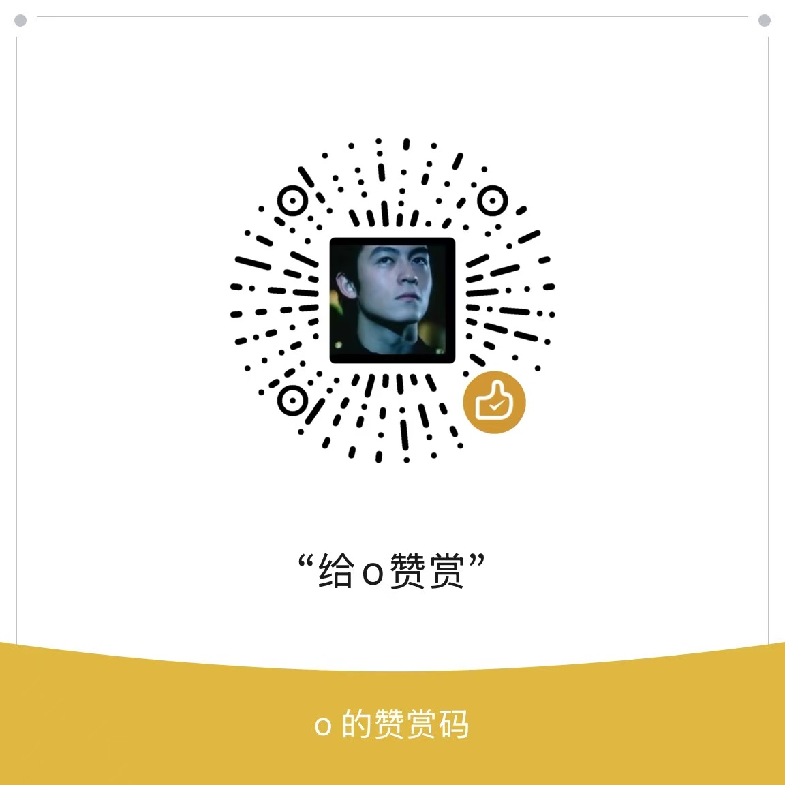

# CreatorHub

本地运行的多平台内容管理工作台，支持 **抖音 / 小红书 / 快手 / 视频号 / TikTok / 哔哩哔哩 / Instagram**。

[在线预览](https://3441293738.github.io/creatorhub/) · [平台能力](#平台能力) · [使用指南](https://3441293738.github.io/creatorhub/guide/) · [下载安装](https://github.com/3441293738/creatorhub/releases/latest) · [问题反馈](https://github.com/3441293738/creatorhub/issues) · [赞赏与交流](#赞赏与交流)

<p align="center">
  <a href="https://3441293738.github.io/creatorhub/">
    <picture>
      <source media="(prefers-color-scheme: dark)" srcset="assets/hero-banner-dark.svg">
      
    </picture>
  </a>
</p>

统一管理账号、采集与监控内容、下载素材和处理发布及互动任务。账号登录态、数据库与媒体文件保存在本地，各平台能力以[使用指南](https://3441293738.github.io/creatorhub/guide/#welcome)为准。

> 在线预览使用脱敏示例数据，仅展示界面与交互；真实登录、采集、下载和发布需要在本地运行。

## 平台能力

| 平台 | 主要功能 |
|---|---|
| 抖音 | 作品 / 评论 / 弹幕监控、批量采集、下载、发布与私信管理 |
| 小红书 | 笔记 / 评论监控、关键词与收藏采集、下载、发布与私信管理 |
| 快手 | 作品 / 评论监控、批量采集、下载与发布 |
| 视频号 | 本账号作品、数据与发布；连接本机微信后支持关键词 / 创作者采集、作品 / 评论监控与加密视频下载 |
| TikTok | 关键词视频采集、作品 / 评论监控、下载、视频发布与用户互动 |
| 哔哩哔哩 | 关键词 / UP 主 / 本账号批量采集、视频与动态监控、评论 / XML 弹幕监控、下载、分区投稿 / 图文动态发布与私信管理 |
| Instagram | 关键词 / 话题 / 创作者 / 本账号批量采集、主页与评论监控、轮播与 Reels 下载、单图 / 轮播 / Reels / Story 发布与 Direct 私信管理 |

> 视频号读取他人内容和下载视频需要先在「设置 → 视频号微信通道」连接本机已登录的桌面微信；TikTok 当前支持单视频发布，暂不支持图文发布与直播。详细能力、操作步骤和使用限制见[使用指南](https://3441293738.github.io/creatorhub/guide/#welcome)。

## 快速开始

### Windows 安装版（推荐）

1. 在 [Releases](https://github.com/3441293738/creatorhub/releases/latest) 的 Assets 中下载 `CreatorHub-Setup-版本-windows-x64.exe`。
2. 双击安装，通过桌面快捷方式启动。
3. 点击「启动本地服务」，等待浏览器组件准备完成，打开工作台并登录账号。

适用于 Windows 10/11 x64，无需手动安装 Python；安装与首次启动请保持联网。版本更新见[更新与备份](https://3441293738.github.io/creatorhub/guide/#backup)。

### 源码运行（开发者 / macOS / Linux）

准备 Python 3.10+ 和桌面环境，其他依赖与平台要求见[安装指南](https://3441293738.github.io/creatorhub/guide/#install)。

```bash
git clone https://github.com/3441293738/creatorhub.git
cd creatorhub
```

Windows：

```powershell
.\start.cmd
```

macOS / Linux：

```bash
chmod +x start.sh
./start.sh
```

首次运行自动准备虚拟环境、Python 依赖、浏览器组件和 `config.yaml`，随后打开 `http://127.0.0.1:8000`。

## 使用文档

详细功能、平台差异、操作步骤和配置统一维护在 **[使用指南](https://3441293738.github.io/creatorhub/guide/)**：

- 按平台上手：[抖音](https://3441293738.github.io/creatorhub/guide/douyin/) · [小红书](https://3441293738.github.io/creatorhub/guide/xhs/) · [快手](https://3441293738.github.io/creatorhub/guide/kuaishou/) · [视频号](https://3441293738.github.io/creatorhub/guide/shipinhao/) · [TikTok](https://3441293738.github.io/creatorhub/guide/tiktok/) · [哔哩哔哩](https://3441293738.github.io/creatorhub/guide/bilibili/) · [Instagram](https://3441293738.github.io/creatorhub/guide/instagram/)
- 日常使用：[功能手册](https://3441293738.github.io/creatorhub/guide/#monitor) · [配置与账号环境](https://3441293738.github.io/creatorhub/guide/#settings) · [更新与备份](https://3441293738.github.io/creatorhub/guide/#backup)
- 开发参考：[配置示例](config.example.yaml) · [更新日志](CHANGELOG.md) · [文档维护](guide/README.md)

## 技术栈

基于 Python、FastAPI、SQLite 与兼容 Playwright 的浏览器自动化接口。浏览器按平台使用系统 Chrome/CDP 或 [Patchright](https://github.com/Kaliiiiiiiiii-Vinyzu/patchright)。

## Star History

<picture>
  <source media="(prefers-color-scheme: dark)" srcset="https://raw.githubusercontent.com/3441293738/creatorhub/star-history/assets/star-history-dark.svg">
  
</picture>

## 赞助商

<p align="center">
  <a href="https://www.ipwo.net/?code=PPBFE3E2F" target="_blank" rel="noopener noreferrer">
    
  </a>
</p>

<p align="center">
  <a href="https://www.ipwo.net/?code=PPBFE3E2F" target="_blank" rel="noopener noreferrer">IPWO</a>
  住宅代理资源，适用于爬虫开发、数据研究、市场分析等场景，为开发者探索更多数据应用方向提供支持。
  <br>
  覆盖 195+ 地区，包含动态代理 / 静态代理 / 不限量代理，支持 HTTP / HTTPS / SOCKS5 多种协议。
  可免费试用，优惠折扣码：<code>0201</code>。
</p>

## 赞赏与交流

如果 CreatorHub 对你有帮助，欢迎自愿赞赏，支持项目持续维护与改进。

欢迎加入 **CreatorHub 交流群**，交流使用经验、问题反馈和功能建议。

<table>
  <tr>
    <th align="center" width="25%">赞赏支持</th>
    <th align="center" width="25%">微信交流群</th>
    <th align="center" width="25%">QQ 交流群</th>
    <th align="center" width="25%">添加作者微信</th>
  </tr>
  <tr>
    <td align="center" valign="middle">
      <a href="assets/community/wechat-reward.jpg">
        
      </a>
    </td>
    <td align="center" valign="middle">
      <a href="assets/community/wechat-group.png">
        
      </a>
    </td>
    <td align="center" valign="middle">
      <a href="assets/community/qq-group.jpg">
        
      </a>
    </td>
    <td align="center" valign="middle">
      <a href="assets/community/wechat-personal.jpg">
        
      </a>
    </td>
  </tr>
</table>

<p align="center">
  使用微信扫码赞赏、加入微信群或添加作者；QQ 群可用 QQ 扫码，或搜索群号 <b>1048219261</b> 加入。点击图片可查看原图。
  <br>
  赞赏金额随心，感谢每一份支持！入群遇到问题，也可以添加作者微信联系。
</p>

## 友链

- [LINUX DO](https://linux.do/) — 感谢社区提供的帮助与支持。

## 使用须知

本项目用于技术学习和个人内容管理，不提供账号、Cookie、代理或平台数据。使用时请遵守目标平台规则及所在地法律法规，并尊重内容版权和个人隐私。
